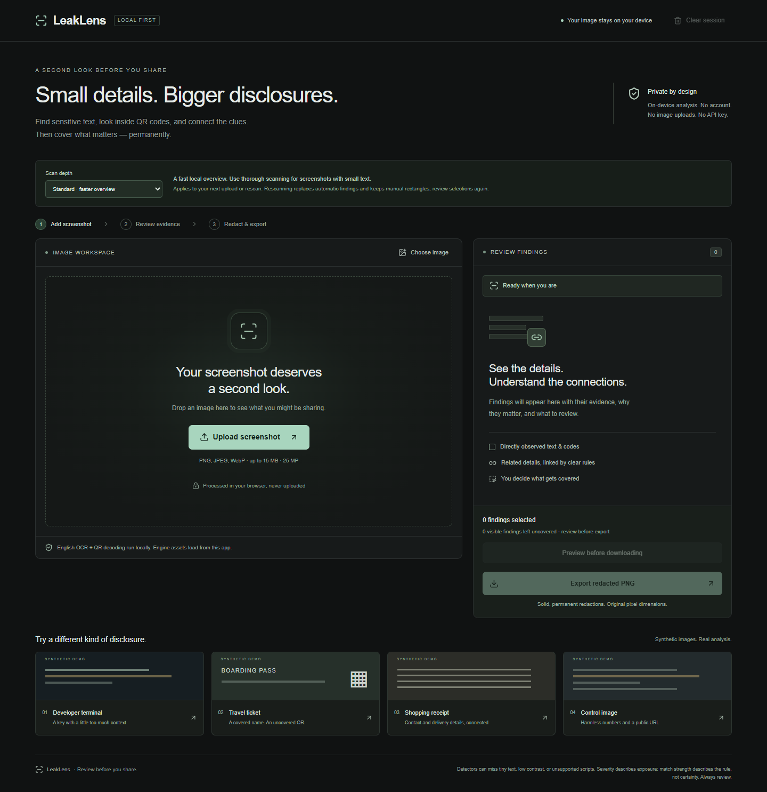

# LeakLens

**Review before you share.** LeakLens is an open-source hackathon project for people who share screenshots of terminals, tickets, receipts, and everyday apps. It finds potentially sensitive text and QR content, connects related disclosures with traceable rules, and exports a permanently redacted PNG.



## Run locally

Use Node.js 22 or newer and npm. Dependencies are pinned by `package-lock.json`.

```sh
npm ci
npm run fixtures
npm run dev
```

Open **http://127.0.0.1:3000**. Choose a demo card or upload a PNG, JPEG, or static WebP. Review both stage statuses, selections and explanations, then export. All four demos run the real pipeline.

`npm ci` runs `prepare`, copying installed OCR/QR assets into `public/engine`. `predev` and `prebuild` also prepare assets. If installing with lifecycle scripts disabled, run `npm run prepare` yourself. Fixture PNGs are included and can be regenerated with `npm run fixtures`. Sharp's font rendering uses system fonts, so glyph rasterisation may vary between operating systems.

`npm run typecheck` generates Next.js route declarations before running TypeScript, so it also works from a fresh clone without existing build output. Generated `next-env.d.ts`, dependencies, engine assets, build output and test artifacts are intentionally ignored by Git.

For a production-mode local preview:

```sh
npm run build
npm start
```

The core requires no API key. Optional Gemini coaching is disabled by default; see [Gemini setup](docs/GEMINI.md). It sends only an explicitly consented abstract summary and ranks fixed, evidence-grounded advice.

## Implemented

- Image validation: MIME + signature, successful decode, 15MB file and 25MP decoded limits, orientation-aware normalisation, rejection of SVG/GIF/animated PNG/WebP.
- English OCR with individual word boxes and span mapping, plus multi-QR decoding with corner coordinates (up to 16 codes attempted).
- Explainable email, contextual phone, possible credential, labelled booking/order/address, URL/IP and travel rules.
- Evidence-linked travel, delivery and developer groups with explicit limitations. Observed matches and uncertain address inferences are labelled separately.
- Masked previews with deliberate reveal, category filtering, hover/focus correspondence, select/dismiss/restore, shared whole-QR selection, zoom and scroll navigation.
- Manual rectangles by pointer or keyboard coordinate form, bounded undo/redo, original-resolution opaque PNG export.
- Optional local recheck of the actual exported pixels. It compares selected targets by source/type/exact recognised text, checks manual opacity, and keeps results separate from the original review.
- Clear session terminates workers, revokes the source object URL, clears canvas references, findings, history and exported-image state.
- Responsive dark UI, labelled controls, focus indicators and status announcements.

### Review features

- **Before/after comparison:** choose **Preview before downloading** to create the actual full-size flattened PNG without starting a download. The slider reveals the original on the left and the PNG on the right; 0% shows only redacted pixels. **Download reviewed PNG** downloads that exact blob. Editing, undo/redo, replacement or clearing revokes the old preview and resets review prompts. The comparison deliberately reveals original content; do not share a screenshot of it as a redacted artifact.
- **Sharing-purpose presets:** **Report a bug**, **Share a ticket**, and **Post a receipt** describe suggested categories. **Add suggested selections** only adds coverage; it does not remove existing selections or revive dismissed findings. Ticket suggestions also cover detected journey context. Names/payment details still need manual review.
- **Exposure connection map:** category/source nodes link to a deterministic rule interpretation. **Why are these connected?** highlights its linked image regions; node focus highlights individual evidence. The map contains labels, not raw secret values. Group details remain available as text, and dismissed members are marked.
- **Guided final review:** four optional prompts cover identity, references/QR, background details and the actual PNG preview. These are user confirmations, not detection results or a safety certificate. They do not gate download or provide a safety score.
- **Thorough scan mode:** select it before upload or use **Rescan at selected depth**. It scans an overview and overlapping original-resolution tiles sequentially, restores crop offsets, merges overlapping duplicate evidence and rebuilds groups. Small images already at original resolution need only one pass. Rescanning replaces automatic findings and their prior edits but keeps manual rectangles; review selections again.
- **Batch redactions:** select contact details, cover all QR codes, or restore default selections. QR payload members remain linked, batch edits can be undone, and manual rectangles/dismissals are preserved by defaults.

To demonstrate multiple tiles, choose **Thorough** and upload `public/demos/thorough.png` (3200×900). It is a reproducible synthetic regression image; the four main demo cards remain unchanged.

## Privacy and network behaviour

Image decode → OCR/QR → detectors → relationship rules → review → redaction → PNG export all happen **in the browser**. There is no image upload route, remote model call, analytics, session replay, credential validation, or automatic fetching of decoded URLs. Untrusted content is rendered as React text, never HTML. Screenshots and findings are not written to localStorage or IndexedDB; Tesseract language caching is disabled.

The page, JavaScript, worker, WASM and English language assets are initially fetched from the app's own origin. They can be sizeable. npm installation needs internet access. A browser integration test completes a scan while blocking third-party HTTP requests; this is **not** a claim that a fresh visit works without the app server or that a service worker caches everything offline. Next.js development may also use a same-origin hot-reload connection. Framework build telemetry is separate from application data; set `NEXT_TELEMETRY_DISABLED=1` if you want to disable it.

Clear session releases references; JavaScript cannot promise secure memory erasure. Downloaded files remain on disk until you remove them. Browser extensions and a compromised device are outside the privacy boundary.

## Architecture

```text
Next.js App Router (serves app and same-origin engine/fixture assets)
  └─ Client review component — memory-only session / revision invalidation
       ├─ ImageBitmap → orientation-normalised original canvas
       ├─ Downscaled analysis canvas (maximum edge 2400px)
       │    ├─ OCR orchestration worker → Tesseract engine worker
       │    └─ QR worker → ZXing WASM → payloads + corner coordinates
       ├─ Scale boxes back to original pixels
       ├─ Modular regex detectors → findings → deterministic relationship rules
       └─ Fresh original-size canvas + opaque black rectangles → PNG
```

The app uses Next.js/React/TypeScript, Tailwind CSS, Lucide, Zod, Tesseract.js and ZXing WASM. Heavy engine code is only loaded through client-side workers. QR and OCR failure statuses are independent. A monotonically increasing revision prevents stale file loads, demo fetches, scans or export rechecks from overwriting the current session.

Thorough mode uses 1800px tiles with 240px overlap, up to 24 tiles. It refuses unsupported extreme aspect ratios rather than silently leaving gaps. It stops starting new tiles after a three-minute budget; an already-running pass can take up to its own OCR/QR timeout. Any failed pass or skipped tile leaves a partial result. Tiles reuse the same local asset URLs and run one pass at a time to bound concurrent work. Rechecking uses the original scan mode. No new data boundary or API is introduced.

Source map:

| File | Responsibility |
| --- | --- |
| `src/lib/model.ts` | Finding, exposure group and analysis contracts |
| `src/lib/image.ts` | Upload validation, normalisation, export and cleanup |
| `src/lib/analysis.ts` | Workers, time bounds, statuses and coordinate transforms |
| `src/lib/ocr.worker.ts`, `qr.worker.ts` | Local heavy analysis |
| `src/lib/detectors.ts` | Detector assumptions and relationship rules |
| `src/lib/geometry.ts` | Scaling, pointer mapping, QR bounds and clamping |
| `src/lib/tiles.ts` | Tile coverage planning, crop-offset restoration and overlap deduplication |
| `src/lib/review.ts` | Additive presets, shared QR batch selections and review prompts |
| `src/components/LeakLens.tsx` | Session, review and redaction interaction |
| `scripts/` | Reproducible fixtures, local assets and fixture evaluation |

## Detector and relationship design

Severity is exposure relevance (`high`, `medium`, `context`), while confidence is rule strength (`strong`, `moderate`), **not a calibrated probability**. There is no safety score. A match is not proof that data is real, a credential is active, or a service is accessible.

Credential patterns cover AWS access-key IDs (`AKIA…`), GitHub classic/fine-grained token shapes, Stripe `sk_live_…`, conservative JWT-like strings, and explicit API_KEY/ACCESS_TOKEN/TOKEN/SECRET/PASSWORD assignments. Redacted placeholders, `your_…`, `changeme`, empty and short values are excluded. Entropy is not used as an independent detector. Phone detection supports labelled Indian mobile shapes and explicitly prefixed international formats; it does not validate allocation. Addresses require a label and a numbered address-like line and are marked as uncertain inferences.

Railway reservations have an additional conservative fallback: multiple document cues (for example, electronic reservation slip plus passenger details) allow an unlabelled ten-digit value to be selected as a **possible** PNR. This handles obscured PNR labels without treating every long number as a booking. Labelled contacts are excluded. Train-labelled five-digit values and number/name pairs in these documents are also selected for journey privacy; train numbers themselves are public information. `public/demos/railway.png` is an additional synthetic regression fixture with a covered PNR label, separate from the four demo cards.

Email spans, labels and multiword assignments map to participating OCR word boxes. The exact same full-resolution coordinate space is used for overlays, manual rectangles and export. QR payload entities have no independent text coordinates: they all use the whole QR. Export adds padding (4px for text; at least 12px or 6% for QR) and clamps to image bounds.

Relationships require explicit category combinations and nearby boxes (gap less than 280 original pixels) or a shared QR. Travel requires travel context + booking/QR; delivery requires address + contact + order; developer requires credential + URL/IP context. Groups with shared evidence under the same rule are merged. Spatially separate travel evidence can produce separate groups. No combined risk total is calculated.

## Verification

```sh
npm test
npm run typecheck
npm run lint
npm run build
npm run test:e2e
```

Browser tests default to installed Google Chrome. For Edge, set `PLAYWRIGHT_CHANNEL=msedge`. For Playwright-managed Chromium, install it with `npx playwright install chromium` and set `PLAYWRIGHT_CHANNEL=chromium`. On PowerShell: `$env:PLAYWRIGHT_CHANNEL='msedge'` before the command. The initial test-browser download was blocked in the development environment, so installed Chrome was used.

Unit tests exercise false positives, overlapping matches, contextual labels, malformed inputs, relationship proximity, QR evidence mapping, scaling, display mapping and bounds. Browser tests exercise real OCR/QR, selection and dismissal, keyboard manual rectangles, undo/redo, exported opaque pixels, unchanged pixels and dimensions, QR unreadability after export, OCR failure, stale scans, corrupt input, orientation, WebP, mobile layout, third-party request blocking, and delayed demo clearing.

Local verification passed **34 unit tests, 18 browser tests against the production server, type checking, lint, and the production build**. See the [verification record](docs/VERIFICATION.md) for environment details and verification limits, and the [submission review](docs/SUBMISSION-REVIEW.md) for follow-up fixes and remaining defects/coverage limits.

With the server running, `node scripts/evaluate-fixtures.mjs` regenerates screenshots and the measured [fixture results](docs/fixture-results.json). See [evaluation and limitations](docs/EVALUATION.md) for the observed detections and misses. This is a small synthetic evaluation, not a real-world accuracy benchmark.

## Important limitations

- English only. Tiny/rotated/low-contrast text, handwriting, unsupported scripts, stylised QR and OCR character substitutions can be missed. Barcode formats other than QR are not enabled.
- Names are not detected as standalone personal entities. An email/phone/address rule cannot find every form of identifying data. Covered names may still exist inside QR payloads.
- Proximity uses a fixed pixel gap; it is a heuristic and can connect unrelated nearby items or miss related distant ones. There is no document-semantic model.
- Thorough scanning costs more CPU/memory/time. Cropping can split a QR or long text value, or separate a contextual label from its value. The overview and overlapping tiles reduce this problem but do not eliminate it. Different OCR readings may survive as separate findings and require review.
- The browser decodes before the final pixel-limit check; resource-exhaustion risks remain. Mobile memory/CPU limits vary. Processing has time bounds rather than guaranteed completion.
- The export recheck compares recognised strings exactly; OCR variations can prevent a target match. It cannot establish completeness and is not a safety certificate. Manual coverage checks only verify opaque pixels.
- Selected overlays use the same padded rectangles and opaque fill as export. Overlapping findings/QR members are evidence items, not independent incidents or distinct regions.
- CSP restricts origins and disables objects/framing; it still permits inline Next.js bootstrap/style code. Production removes general eval permission but permits WASM compilation. Nonce-based CSP is future hardening.

**Rechecking can identify some missed redactions. It does not guarantee that all sensitive information has been removed.** Always inspect the downloaded image before sharing.

## Project notes

- [Threat model](docs/THREAT-MODEL.md)
- [90-second demo script](docs/DEMO.md)
- [Engineering decisions for interviews](docs/ENGINEERING.md)
- [MIT licence](LICENSE) and [third-party notices](THIRD_PARTY_NOTICES.md)

The highest-value next improvement is a larger, labelled screenshot evaluation set, using its misses to improve font/block-aware grouping and coordinate coverage. Further work could include safer OCR orientation options, script support, stronger export target matching, and broader evaluation of optional Gemini advice ranking. There is no authentication, database, cloud image storage, or extension. The optional paid Gemini endpoint is restricted to local use.
